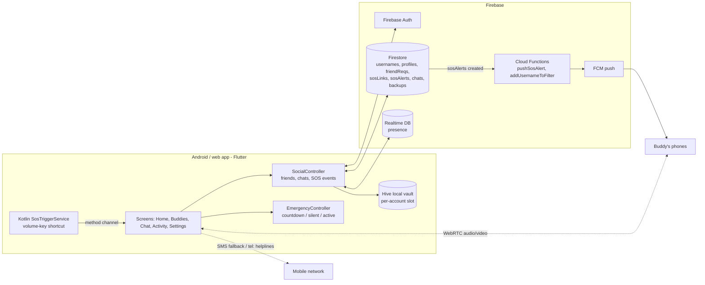

# SafeHer architecture

## SOS flow

1. Start: slide-to-SOS, volume-key shortcut (works when locked), or a missed safe-walk check-in.
2. Countdown (3/5/10 s) unless **silent SOS** is on for the shortcut.
3. One `sosAlerts/{eventId}_{buddy}` document per approved buddy; rules allow it only when `sosLinks` says the buddy approved.
4. `pushSosAlert` wakes every registered phone of the buddy (`pushTokens/{name}/devices/*`), retrying transient FCM failures, and stamps `pushedAt`.
5. Location is published by movement; camera/mic stream over WebRTC.
6. No internet: the active SOS sheet opens the SMS app with a maps link; Home lists 15 / 1122 / 1099 / 115.
7. Ends with "I am safe", cancel, or the same shortcut presses.

## Data protection

- Chat is end-to-end encrypted on the device (`lib/e2ee.dart`); backups are sealed client-side (`lib/cloud_backup.dart`).
- Firestore, Realtime DB and Storage rules are deny-by-default and covered by `backend-tests/`.
